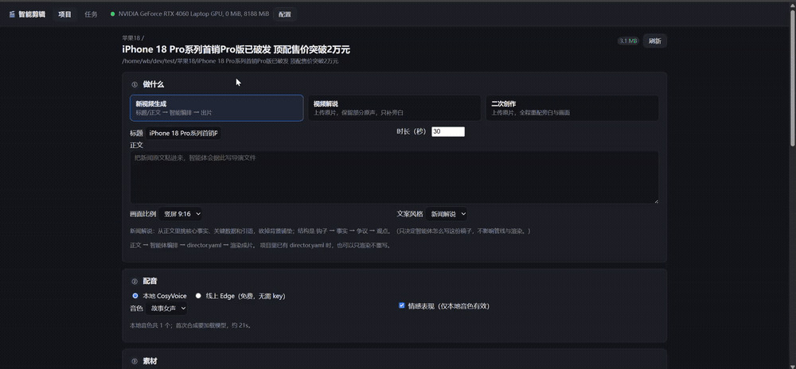

# 🎬 AI Video Director

**English** | [中文](README.md)

> Give it a **title** or **web page URL**. The AI does the rest: web search → script writing → pacing & emotion → voice-cloned narration → visuals → background music → burned-in subtitles → final video.

A fully self-hosted short-video generation pipeline. The core idea is an **"AI Director"** pattern: an LLM acts as director, turning a title into an emotion-annotated **shot list** (`director.yaml`), which an ffmpeg execution layer then renders scene by scene into a finished video.

> ℹ️ **Language note:** the TTS, voice cloning, and subtitle stack is primarily built for **Chinese** output (CosyVoice3 + Chinese fonts + Chinese narration prompts). English narration works via the `edge:` backend, but the expressive-TTS and dubbing features are Chinese-first. Code comments and prompts are in Chinese.

<br>

## 📖 Contents

- [Features](#features)
- [Three pipelines](#three-pipelines)
- [How it works](#how-it-works)
- [Requirements](#requirements)
- [Installation](#installation)
- [Quick start](#quick-start)
- [Web UI](#web-ui)
- [Configuration](#configuration)
- [Paths & portability](#paths--portability)
- [Troubleshooting](#troubleshooting)
- [License](#license)

<br>

## Features

| Feature | Description |
|---------|-------------|
| 🎤 **Voice cloning** | Clone a voice from ~3s of reference audio. Registration runs 5 audio-quality checks (bitrate / SNR / dynamics / detail / low-freq) and **rejects** material that fails |
| 😮💨 **Expressive TTS** | The LLM reads the text and auto-inserts `[breath]` `[sigh]` `[laughter]` markers, producing speech with breathing, sighing, laughter and emphatic stress |
| 🗣️ **Dialects** | 17 Chinese dialects (Cantonese, Sichuanese, Northeastern, …) |
| 🎬 **AI Director** | LLM searches the web → writes the script → segments by emotion → assigns a visual source and BGM per scene |
| 🎞️ **Remix / re-cut** | Shot detection + transcription + visual understanding on an existing video, then re-cut into a new one |
| 🔍 **Automatic footage** | Write `搜索:city night` ("search: city night") in the plan and it downloads matching footage from Pexels, cached for 24h |
| 💬 **Rounded subtitles** | ASS subtitles with rounded translucent backgrounds, burned into the frame |
| 🧩 **Transitions** | Cross-dissolve (`xfade`) between scenes; shot duration derived from narration pacing |
| 🖥️ **Web UI** | Local FastAPI server — pick a pipeline, upload material, watch progress, download the result |

<br>

## Three pipelines

```
① General    title/URL ──→ director.yaml ──→ video_make_ffmpeg.py ──→ video
                (AI director writes script)      (ffmpeg scene rendering)

② Remix      source video ──→ analysis.json ──→ remix.yaml ──→ render_remix.py ──→ video
                (shot detect + transcribe + VLM)   (re-cut editing plan)

③ Voice      text / reference audio ──→ tts_express.py / voice_cli.py ──→ narration
```

<br>

## How it works

```
User (title / URL / material)
    ↓
┌─ AI Director ─────────────────────────────┐
│  web search → content analysis → script    │
│  emotion pacing → visual & BGM plan        │
│  outputs director.yaml                     │
└────────────────────────────────────────────┘
    ↓ user confirms
┌─ Render layer ────────────────────────────┐
│  tts_express.py    → emotional speech      │
│  Pexels / local    → visuals               │
│  per-scene render  → xfade transitions     │
│  ass_subtitle.py   → rounded subtitles     │
│  bgm_prep.py       → BGM mixing            │
│  encoder.py        → MP4 output            │
└────────────────────────────────────────────┘
```

<br>

## Requirements

| Item | Requirement |
|------|-------------|
| **OS** | Linux (WSL2 works). Tested on Ubuntu 22.04 + WSL2 |
| **Python** | 3.11 (on 3.10 you additionally need `tomli`) |
| **GPU** | NVIDIA, ≥ 8GB VRAM (CosyVoice3 synthesis + transcription). CPU-only works but is much slower |
| **CUDA** | 12.1 (matching torch 2.3.1+cu121) |
| **ffmpeg** | ≥ 4.4. **5.x+ recommended** — 4.4 has a known two-video-stream filter bug; this project works around it with a "three-step" method, see [Troubleshooting](#troubleshooting) |
| **Disk** | ~15GB of models; allow 30GB with the footage cache |

<br>

## Installation

### 1. System packages

```bash
sudo apt update
sudo apt install -y ffmpeg fonts-wqy-zenhei tesseract-ocr tesseract-ocr-chi-sim
```

- `fonts-wqy-zenhei` — Chinese subtitle font (`ass_subtitle.py` expects `wqy-zenhei.ttc`; change the `FONT` constant to use another)
- `tesseract` — only used by the legacy subtitle-verification path; optional (the recommended approach is now multimodal verification via `ocr_k3.py`)

### 2. Clone this repo

```bash
git clone <this repo> ai-video-director
cd ai-video-director
```

### 3. Clone CosyVoice (**required** — separate repo)

The voice-cloning engine is the official [FunAudioLLM/CosyVoice](https://github.com/FunAudioLLM/CosyVoice), which is **not** vendored here. Clone it into the project root:

```bash
git clone --recursive https://github.com/FunAudioLLM/CosyVoice.git
```

> ⚠️ The `--recursive` flag matters. Without it `third_party/Matcha-TTS` is empty and `import cosyvoice` fails.

### 4. Virtualenv & dependencies

```bash
python3.11 -m venv video-env
source video-env/bin/activate

# CosyVoice's deps first — they pin the heavy packages (torch, etc.)
pip install -r CosyVoice/requirements.txt

# Then this project's
pip install -r requirements.txt
```

> Order matters: both files pin torch/torchaudio versions, and installing in the wrong order lets them clobber each other.

### 5. Download models

Into `models/`:

```bash
mkdir -p models

# ① Voice-cloning weights (~5GB, required)
modelscope download --model FunAudioLLM/Fun-CosyVoice3-0.5B-2512 \
    --local_dir models/Fun-CosyVoice3-0-5B-2512

# ② ASR weights (~500MB, required: used for transcription and voice-registration checks)
huggingface-cli download Systran/faster-whisper-small \
    --local-dir models/whisper-small

# ③ Demucs vocal separation (optional; only for bgm_prep.py --separate)
#    Auto-downloaded to ~/.cache on first use, no manual step
```

Models can live elsewhere — point `MODELS_DIR` / `COSYVOICE_MODEL` / `WHISPER_MODEL` at them, see [Paths & portability](#paths--portability).

### 6. Configure keys

Edit `config.toml` in the project root (shipped as a **template with no real keys**):

```toml
[llm]
base_url = "https://api.deepseek.com/v1/chat/completions"
api_key  = ""              # ← your LLM key
model    = "deepseek-v4-flash"

[pexels]
api_key = ""               # ← your Pexels key; free at https://www.pexels.com/api/
```

- **An LLM key is required** (script writing, editing plan, expressive markers all need it). Any OpenAI-compatible endpoint works, not just DeepSeek — change `base_url` + `model` and the request-parameter profile adapts automatically.
- **The Pexels key is optional.** Without it, `搜索:keyword` auto-footage is unavailable; manually dropping files into `素材/` still works.
- Environment variables override the file without editing it: `LLM_API_KEY` / `LLM_API_URL` / `LLM_MODEL` / `PEXELS_API_KEY`.

> 🔒 **Once you've added real keys, don't commit them.** The easy way is to make git ignore your local edits to this file:
> ```bash
> git update-index --skip-worktree config.toml
> ```

### 7. Verify

```bash
python verify_env.py
```

Prints `✅ 全部验证通过！` on success, covering torch / CUDA / VRAM / CosyVoice loading.

### 8. (Optional) Vision model environment

"Image understanding" (reading your uploaded images and describing them for the scriptwriter) runs in a **separate environment** — it needs transformers 5.x while the main env is pinned to 4.51.3 by CosyVoice, and the two conflict. The project therefore points at it via `project_paths.VLM_PYTHON` and calls it as a subprocess.

Skipping this doesn't affect the main flow; just set `[vlm] enabled = false` in `config.toml`.

To install it:

```bash
python3.11 -m venv vlm-env
./vlm-env/bin/pip install -r vlm-requirements.txt
modelscope download --model Qwen/Qwen3.5-2B --local_dir models/Qwen3.5-2B
```

<br>

## Quick start

### Register a voice first

The pipelines default to a voice named `故事女声`. Register one from any clean, ≥3s speech sample:

```bash
source video-env/bin/activate
python voice_cli.py 注册 reference.wav "the words spoken in the reference" --spk-id 故事女声
python voice_cli.py 列表          # list registered voices
```

Registration runs 5 audio-quality checks and **rejects with a reason** on failure; if it passes, a whisper round-trip test is run and registration is rolled back if match rate is below 30%.

> To just try it without registering: `python tts_express.py "Hello, welcome to the show." reference.wav --express`

### Pipeline ① General (title → video)

`director.yaml` is both the AI director's output and the renderer's input:

```yaml
project:
  title: "End-to-end test"
  duration: 20

voice:
  spk_id: "故事女声"
  express: false
  speed: "中"

scenes:
  - id: 1
    narration: "This scene uses a local image and verifies the render pipeline."
    mood: "平实"
    visuals:
      type: "image"
      source: "641.webp"          # local image

  - id: 2
    narration: "This scene pulls footage automatically from Pexels."
    mood: "兴奋"
    visuals:
      source: "搜索:城市夜景"      # auto-search Pexels for "city night"

bgm:
  path: ""          # empty = no BGM
  volume: 0.25
  fade_in: 2
  fade_out: 3

output:
  path: ""
  subtitle: true    # burn in subtitles
```

Write one by hand, or let the AI director generate it, then render:

```bash
python video_make_ffmpeg.py director.yaml
```

**Manual footage**: create a `素材/` directory in the project (images and short clips side by side, distinguished by extension). Scenes with empty `visuals` — or several scenes sharing one pool — get assigned round-robin.

### Pipeline ② Remix (source video → re-cut)

```bash
# 1. Analyze: shot detection + transcription + visual understanding → analysis.json
python analyze_video.py source.mp4 workdir/

# 2. Plan the re-cut (optionally inspect footage gaps first)
python check_materials.py workdir/
python plan_remix.py workdir/ --bgm music.mp3     # → remix.yaml

# 2b. Resolve any "搜索:keyword" entries
python resolve_materials.py workdir/ --plan       # list keywords for review/edit
python resolve_materials.py workdir/              # download and rewrite yaml to local paths

# 3. Render
python render_remix.py workdir/ --bgm music.mp3   # → final_remix.mp4
```

`remix.yaml` scene types: `original` (cut from the source, optionally keeping its audio) / `image` (with Ken Burns push) / `clip` / `text` (end card). See [`二创/README.md`](二创/README.md) (Chinese).

### Pipeline ③ Voice tools

```bash
# Expressive synthesis (LLM inserts markers automatically)
python tts_express.py "He went quiet, sighed deeply, then said: I give up." ref.wav --express

# Registered voice + dialect
python tts_express.py "今天天气真好" --spk-id 故事女声 --express --lang 四川话

# Plain cloning CLI
python voice_cli.py 合成 "Hello, this is the narrator."
```

Offline, `--express` degrades to heuristic rules (punctuation/keyword based) instead of failing.

<br>

## Web UI

```bash
source video-env/bin/activate
python -m web.server              # or: uvicorn web.server:app
# → http://127.0.0.1:8000
```

In the browser: pick a pipeline → fill in parameters → upload material → watch live progress (SSE) → preview and download the result. LLM / Pexels settings are editable in the UI; writing back to `config.toml` preserves the file's comments.

### Walkthrough

> The clip shows: create a project → enter title and duration → choose voice / aspect ratio / subtitle style → set up footage → render → preview and download the result.

[](docs/media/demo.mp4)

For the sharp version (1920×892), [play `demo.mp4`](docs/media/demo.mp4).

<br>

## Configuration

`config.toml` is the **single** config file. Resolution order is always **env var > this file > neutral default**.

| Section | Key | Description |
|---------|-----|-------------|
| `[llm]` | `base_url` / `api_key` / `model` | Any OpenAI-compatible endpoint. The request-parameter profile (whether `reasoning_effort` is sent) is derived from the model — see `pipeline_config.profile_for()` |
| `[tts]` | `active` | Only controls which tab is pre-selected in the UI, **not rendering**. Rendering only looks at the voice-name prefix |
| | `[tts.backends.*]` | `edge:` prefix = online Edge TTS (free, no key); `openai:` prefix = any OpenAI-compatible `/audio/speech` service; no prefix = local CosyVoice |
| `[vlm]` | `enabled` / `model_dir` / `timeout` | Image understanding. Triggered **only by manually uploaded images** — auto-extracted frames and Pexels footage are never fed to it (~10s + 4.2GB VRAM per image) |
| `[pexels]` | `api_key` | Footage provider key |
| `[defaults]` | `spk_id` / `size` / `express` / `speed` / `optimize` / `cuda` | UI and director defaults |
| `[runner]` | `max_upload_mb` | Web upload size limit |

<br>

## Paths & portability

Every path *outside* the project is centralized in **`project_paths.py`**, and every one of them can be overridden by an environment variable. Move the project, change machines — no code edits needed.

| Env var | Default | Purpose |
|---------|---------|---------|
| `PROJECT_ROOT` | directory of this file | project root |
| `COSYVOICE_DIR` | `<root>/CosyVoice` | CosyVoice source |
| `MODELS_DIR` | `<root>/models` | model root |
| `COSYVOICE_MODEL` | `<MODELS_DIR>/Fun-CosyVoice3-0-5B-2512` | voice-cloning weights |
| `WHISPER_MODEL` | `<MODELS_DIR>/whisper-small` | ASR weights |
| `DEMUCS_REPO` | `<MODELS_DIR>/demucs_repo` | vocal-separation model |
| `REF_AUDIO` | `<COSYVOICE_DIR>/asset/zero_shot_prompt.wav` | official reference audio for registration |
| `PIPELINE_PYTHON` | current interpreter | Python used for pipelines |
| `VLM_PYTHON` | `<root>/vlm-env/bin/python` | vision model's separate env |
| `VLM_MODEL_DIR` | `<root>/models/Qwen3.5-2B` | vision model weights |
| `MPT_CONFIG` | `<root>/MoneyPrinterTurbo/config.toml` | optional: reuse MoneyPrinterTurbo's key |
| `BGM_DIR` | `<root>/BGM` | BGM output directory |

Example — models live in `/data/models`, one env var and you're done:

```bash
export MODELS_DIR=/data/models
python video_make_ffmpeg.py director.yaml
```

<br>

## Troubleshooting

<details>
<summary><b><code>import cosyvoice</code> fails</b></summary>

Almost always a clone without `--recursive`, leaving `third_party/Matcha-TTS` empty. Fix:

```bash
cd CosyVoice && git submodule update --init --recursive
```
</details>

<details>
<summary><b>ffmpeg version and the two-stream filter bug</b></summary>

ffmpeg 4.4 has a known bug with "two video streams + filter" (the reference dev machine runs 4.4). Every complex concatenation here uses a **three-step** method: extract tracks → apply filters → merge, so that no single command ever carries two video streams.

On ffmpeg 5.x / 6.x everything runs normally with no special handling.
</details>

<details>
<summary><b>Out of VRAM (OOM)</b></summary>

- Set `[vlm] enabled = false` in `config.toml` — the vision model is the biggest consumer at 4.2GB per image
- Transcription automatically falls back from `cuda/float16` to `cpu/int8`: slower, but it won't crash
- `[defaults] cuda = 0` selects the GPU
</details>

<details>
<summary><b>No Chinese in subtitles / tofu boxes</b></summary>

Missing Chinese font. Install `fonts-wqy-zenhei`, or point the `FONT` constant in `ass_subtitle.py` / `video_make_ffmpeg.py` at a font file that exists on your system (`.ttf` / `.ttc`).
</details>

<details>
<summary><b>Voice registration keeps getting rejected</b></summary>

There are 5 hard audio thresholds (bitrate ≥128kbps, SNR ≥30dB, crest factor ≥3.5, ZCR ≥0.08, low-freq ≤45%). Use speech recorded in a **quiet room, without background music**, 3–10 seconds long, and make sure the reference text **matches the audio word for word**.
</details>

<details>
<summary><b>Synthesized audio is too short / sounds bad</b></summary>

Aim for 20+ characters of synthesis text; a mismatch between reference audio and reference text noticeably degrades cloning. CosyVoice appends `<|endofprompt|>` to the reference text automatically — don't add it manually. Audio is 24000Hz mono throughout.
</details>

<details>
<summary><b>LLM features say "please configure a key"</b></summary>

`[llm] api_key` in `config.toml` is empty. Fill it in, or set `LLM_API_KEY` in the environment.
</details>

<br>

## Directory structure

```
ai-video-director/
├── project_paths.py        # 🧭 single source of truth for external paths (env-overridable)
├── pipeline_config.py      # 🔑 single source of truth for LLM/VLM config
├── config.toml             # ⚙️  config file (template, no real keys)
│
├── tts_express.py          # 🚀 expressive TTS (core)
├── tts_express_prompt.md   #    marker definitions + prompt template
├── tts_backends.py         #    voice-prefix dispatch (local CosyVoice / Edge / OpenAI-compatible)
├── voice_cli.py            #    register / list / delete / synthesize voices
│
├── video_make_ffmpeg.py    # 🎬 general-pipeline renderer (ffmpeg, primary)
├── video_make.py           #    legacy moviepy renderer (kept for reference)
├── director_agent.py       # 🧠 the AI director
├── text_to_director.py     #    title/text → director.yaml
├── image_brief.py          #    understand project images before writing
├── vlm_analyze.py          #    vision analyzer (separate vlm-env, called as subprocess)
│
├── render_remix.py         # 🎬 remix-pipeline renderer
├── analyze_video.py        #    shot detection + transcription + visual analysis
├── plan_remix.py           #    remix planning
├── check_materials.py      #    footage gap assessment
├── resolve_materials.py    #    auto footage download
│
├── pexels_materials.py     # 🎥 Pexels search / cache / download
├── bgm_prep.py             # 🎵 BGM prep (extract/crop/vocal-separate/loop/normalize)
├── ass_subtitle.py         # 💬 SRT → ASS rounded subtitles
├── xfade_join.py           # 🧩 cross-dissolve join (three-step method)
├── encoder.py              #    encoding parameters
├── speech_rate.py          #    speech-rate analysis
├── ocr_k3.py               #    multimodal OCR (subtitle verification)
├── ocr_img.py              #    Tesseract OCR (legacy)
├── verify_env.py           # ✅ environment self-check
│
├── web/                    # 🖥️  FastAPI web UI
│   ├── server.py           #    entry point: python -m web.server
│   ├── config.py           #    read/write config.toml
│   ├── pipelines.py        #    pipeline registry & param validation
│   ├── jobs.py             #    job queue + SSE progress
│   ├── projects.py         #    project discovery & preview
│   └── static/             #    frontend (vanilla JS, no build step)
│
├── prompts/                # 💡 prompts
├── docs/                   # 📚 detailed docs (Chinese)
├── 二创/ 其他/              # 📁 per-pipeline notes (Chinese)
├── requirements.txt
├── vlm-requirements.txt
└── LICENSE
```

<br>

## License

[MIT](LICENSE). This repository does **not** include CosyVoice source or any model weights — those must be installed separately and are governed by their own licenses (CosyVoice is Apache 2.0).

> ⚠️ **Use voice cloning responsibly.** Do not clone voices without authorization. Do not use this to impersonate people, commit fraud, or for any unlawful purpose. Users are responsible for their own compliance.
